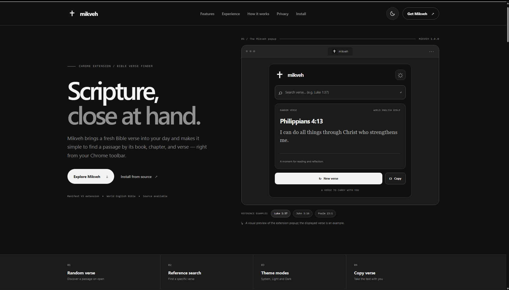

# Mikveh


**Mikveh** is a small, focused Bible verse finder for Google Chrome. Open the extension to receive a random verse, or search for a passage by entering a reference such as `Luke 1:37`. Read the result in a clean popup, copy it with its reference, and choose a System, Light, or Dark appearance.



> **Project status:** Mikveh is not listed in the Chrome Web Store. The project is installed from its Git repository as an unpacked Chrome extension.

## Contents

- [What Mikveh does](#what-mikveh-does)
- [Bible translation and service](#bible-translation-and-service)
- [Download and install](#download-and-install)
- [Use Mikveh](#use-mikveh)
- [How it works](#how-it-works)
- [Privacy and permissions](#privacy-and-permissions)
- [Project files](#project-files)
- [Preview the project website](#preview-the-project-website)
- [Known limitations](#known-limitations)
- [License and third-party services](#license-and-third-party-services)

## What Mikveh does

- **Random verse on open:** When the popup opens, Mikveh requests a random Bible verse and displays its reference and text.
- **Reference search:** Look up a particular passage using a reference such as `Luke 1:37`, `John 3:16`, or `1 Corinthians 13:4`.
- **Alternative reference syntax:** The extension also accepts the original slash format, such as `luke/1:37`.
- **New verse:** Request another random verse without closing the popup.
- **Copy:** Copy the verse reference and verse text together to the clipboard.
- **Three themes:** Cycle through System, Light, and Dark using the theme button in the popup header.
- **Preference persistence:** The selected theme is saved using Chrome's local extension storage.
- **Compact reading interface:** The reference, passage, and key actions are grouped into one compact popup.

Mikveh currently provides verse lookup and random discovery. It does not include accounts, bookmarks, favourites, reading plans, verse history, notes, or cloud synchronisation.

## Bible translation and service

The current extension uses the **World English Bible (WEB)** translation through [bible-api.com](https://bible-api.com/).

The extension makes HTTPS GET requests to the following endpoints:

- Random verse: `https://bible-api.com/data/web/random`
- Specific reference: `https://bible-api.com/<book>+<chapter>:<verse>`

No API key is required by the current implementation. Verse text is retrieved from the remote service; therefore an internet connection is required to load a random verse or search result. Mikveh does not currently provide a translation selector.

## Download and install

Mikveh is not currently available in the Chrome Web Store. Clone the official project repository when its URL is published:

```bash
git clone https://github.com/darshseraphic/Mikveh.git
```

### Add Mikveh to Chrome

1. Clone the repository using the command above.
2. Open Google Chrome and visit `chrome://extensions`.
3. Turn on **Developer mode**.
4. Click **Load unpacked**.
5. Select the cloned Mikveh project folder — the folder that contains `manifest.json` directly.
6. Open Chrome's Extensions menu and pin **Mikveh** to the toolbar.
7. Click the Mikveh toolbar icon to open the verse finder.

**Important:** Do not select a parent folder that contains the project folder. The selected directory must contain `manifest.json` at its top level.

### Update an existing Git checkout

After the repository has been cloned, open a terminal in that repository and run:

```bash
git pull
```

Then open `chrome://extensions` and click the **Reload** icon on the Mikveh extension card.

## Use Mikveh

### 1. Discover a random verse

Click the Mikveh icon in the Chrome toolbar. The popup requests a random WEB verse automatically and displays the passage with its Bible reference.

### 2. Search for a verse

Enter the book, chapter, and verse into the search field. Use this format:

```text
Luke 1:37
```

Other examples:

```text
John 3:16
Genesis 1:1
1 Corinthians 13:4
Psalm 23:1
```

Press **Enter** or click **Read verse**. Mikveh validates the reference format, requests the verse from the API, and displays the result. A valid-looking format does not guarantee that a book, chapter, or verse exists; the service checks the requested passage.

For compatibility, this alternative form is also accepted:

```text
luke/1:37
```

### 3. Request another random verse

Click **New verse** / **Show another random verse** to request a new random selection.

### 4. Copy a passage

Click **Copy** on the verse card. Mikveh copies the reference and passage text together, separated by a line break.

### 5. Change the appearance

Click the theme button in the popup header to cycle through the three settings:

```text
System → Light → Dark → System
```

- **System** follows the operating-system appearance preference.
- **Light** applies the light palette.
- **Dark** applies the dark palette.

The selected theme is remembered in Chrome's local extension storage.

## How it works

1. The popup loads and reads the saved theme preference.
2. It requests a random verse from the WEB random-verse endpoint.
3. When a user searches, Mikveh parses the reference into a book, chapter, and verse, then requests that passage from the API.
4. The returned reference and verse text are inserted into the reading card as text content.
5. The Copy action sends the current reference and passage to the browser clipboard.

The popup logic is implemented in `popup.js`; the interface is defined by `popup.html` and styled by `popup.css`. The extension uses Manifest V3.

## Privacy and permissions

The current `manifest.json` requests only:

- `storage` — to save the selected theme preference.
- Host access to `https://bible-api.com/*` — to retrieve random verses and search results.

The current extension does not request access to active tabs, page contents, browsing history, bookmarks, downloads, or cookies. It does not require a user account. It does not include analytics or a Mikveh-operated backend in the current source.

**Network note:** When you open the popup, a random-verse request is sent to `bible-api.com`. When you search, the requested book, chapter, and verse are included in the request URL. The API provider receives the request and normal network metadata (which can include your IP address). Mikveh does not control the provider's logging or retention practices. Review [SECURITY.md](SECURITY.md) for more detail.

## Project files

The repository combines the Chrome extension, the project website, and project documentation in one root folder.

```text
mikveh/
├── manifest.json          # Chrome Manifest V3 metadata, permissions, popup and icons
├── popup.html             # Semantic structure and controls for the extension popup
├── popup.css              # Popup layout, monochrome themes, responsive styles and focus states
├── popup.js               # Theme storage, reference parsing, API requests, rendering and copy action
├── icons/
│   ├── logo.svg            # Scalable cross mark used in the interface
│   ├── icon16.png          # 16 px Chrome toolbar icon
│   ├── icon32.png          # 32 px icon used by the website and browser UI
│   ├── icon48.png          # 48 px extension management icon
│   └── icon128.png         # 128 px extension listing / install icon
├── docs/
│   ├── index.html          # Responsive Mikveh project website
│   ├── styles.css          # Website layout, responsive design and all three themes
│   ├── script.js           # Website theme control, mobile navigation and clone-command copy
│   ├── config.js           # Placeholder for the future official Git repository URL
│   ├── WEBSITE_README.md   # Local preview and website publishing notes
│   └── DESIGN_CREDITS.md   # Design-reference and asset notes
├── README.md               # Project introduction, installation and usage guide
├── CONTRIBUTING.md         # Contribution and feedback guidance
├── SECURITY.md             # Permissions, data flows and vulnerability reporting
├── CHANGELOG.md            # Version history
└── LICENSE.txt             # Mikveh proprietary source-available license
```

### What each file does

| File | Purpose |
|---|---|
| `manifest.json` | Declares the extension name, version, popup, icons, permissions, and Bible API host access. |
| `popup.html` | Provides the popup's accessible structure, search form, verse card, theme button, and actions. |
| `popup.css` | Defines the popup's layout, monochrome color tokens, System/Light/Dark themes, typography, and responsive behavior. |
| `popup.js` | Handles theme preference storage, reference parsing, random and specific verse requests, loading/error states, verse rendering, and clipboard copy. |
| `icons/logo.svg` | Vector artwork for the Mikveh cross mark. |
| `icons/icon*.png` | Chrome extension icons at the sizes required by the manifest. |
| `docs/index.html` | Provides the public-facing project website and its product information. |
| `docs/styles.css` | Styles the project website and adapts it for smaller screens and all three themes. |
| `docs/script.js` | Controls the website theme button, mobile navigation, repository command, and copy feedback. |
| `docs/config.js` | Holds the repository URL placeholder used by the website's clone command. |
| `README.md` | This project overview and user guide. |
| `CONTRIBUTING.md` | Explains the permitted ways to report issues and suggest improvements under the proprietary license. |
| `SECURITY.md` | Explains permissions, network requests, storage, and security reporting. |
| `CHANGELOG.md` | Records project and extension changes by version. |
| `LICENSE.txt` | States the terms under which Mikveh may be viewed, installed, and used. |
| `docs/WEBSITE_README.md` | Explains how to preview and publish the static project website. |
| `docs/DESIGN_CREDITS.md` | Records the visual references and identifies bundled assets. |

## Preview the project website

The website is static and does not require a build step or package installation. From the project root, run:

```bash
python -m http.server 8000
```

Then open `http://localhost:8000/docs/` in a browser. The project website uses local CSS, JavaScript, and the shared icon assets in `icons/`. It does not load remote fonts, scripts, or verse content.

To publish it with GitHub Pages, configure the repository to publish from the `/docs` folder on the selected branch. Add the official repository URL to `docs/config.js` when it is available.

## Known limitations

- An internet connection is required for random verse and reference requests.
- Verse content is provided by bible-api.com; service availability and response behavior are outside Mikveh's control.
- The current translation is WEB; there is no translation picker.
- The current version does not store verse history, bookmarks, favourites, notes, or reading plans.
- The API may return an error for an unknown or invalid book, chapter, or verse.
- Copy behavior depends on clipboard support provided by the browser; the popup includes a fallback attempt where available.

## License and third-party services

Mikveh is proprietary source-available software. Read [LICENSE.txt](LICENSE.txt) before using the source or an official release. Public source visibility does not grant general rights to modify, fork, redistribute, resell, or commercially exploit the Software.

The extension retrieves Bible text using [bible-api.com](https://bible-api.com/). The World English Bible is the translation selected by the current implementation. Third-party service terms and content notices are separate from the Mikveh license; review the relevant provider information for current terms.

For permission requests, the license lists:

**Darshseraphic**  
Darsh.seraphic@gmail.com
